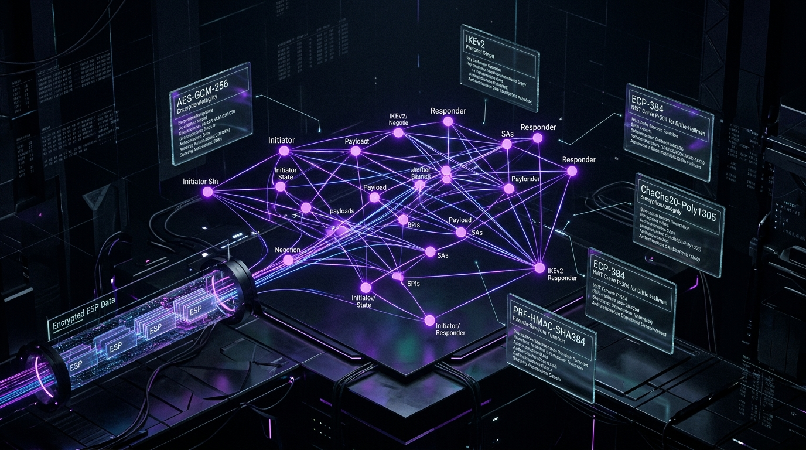
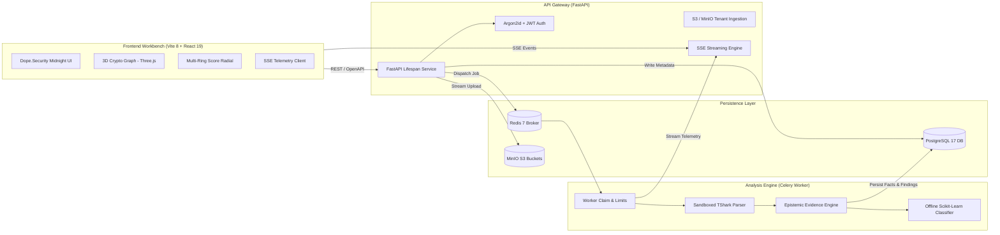

<div align="center">


# IPSEC // ANALYZER
### Automated Posture & Epistemic Cryptographic Evidence Engine for IKEv2 / IPsec

[](https://github.com/amit-dev01/IPSEC/actions/workflows/ci.yml)
[](https://fastapi.tiangolo.com)
[](https://react.dev)
[](https://threejs.org)
[](https://tailwindcss.com)
[](https://www.postgresql.org)
[](https://www.python.org)
[](LICENSE)

<br/>

**Defensive, passive analysis of IPsec packet captures supplied by authorized security engineers.**  
No packet injection · No target probing · No key recovery · Zero transmission of PCAP bytes to external LLMs.

<br/>



</div>

---

## ⚡ Core Philosophy: Epistemic Integrity

> **"Unknown evidence is reported as unknown — never as secure."**  
> *A missing finding is not a clean bill of health. A missing score means evidence coverage was insufficient — never a default pass.*

In enterprise cryptographic assessments, tools frequently commit epistemic fabrication: assuming an encrypted tunnel uses modern algorithms simply because negotiation began over IKEv2. **IPSEC Analyzer** mathematically enforces an evidence boundary:
- **Offered vs Selected**: Client-offered transforms are permanently segregated from responder-selected transforms.
- **IKE-SA vs Child-SA**: Outer IKE negotiation ciphers are strictly decoupled from inner ESP data-phase ciphers.
- **Visibility Boundaries**: If the Child SA transform was negotiated inside an encrypted `IKE_AUTH` exchange without available credentials, the ESP cipher is recorded as `unknown` with a 0% security claim.
- **Data Privacy**: Only packet headers and flow metadata are parsed; inner plaintext is never decrypted, stored, or sent to external AI APIs.

---

## 💎 Advanced Interactive 3D & Telemetry Features

The frontend workbench is built with **React 19**, **Vite 8**, **Tailwind CSS v4**, and **Three.js** (`@react-three/fiber` + `@react-three/drei`) in a **dope.security midnight aesthetic** (deep obsidian surfaces, hairline borders, and neon Signal Violet `#af50ff` accents).

<br/>

### 1. 🌌 3D IKE Cryptographic Node Graph
*Interactive WebGL spatial visualizer located in `CryptoGraph3D.tsx`*
- **3D Spatial Topology**: Renders IKE Security Associations, Diffie-Hellman Key Exchange groups, PRF algorithms, and integrity transforms as glowing 3D nodes connected by dynamic laser arcs in 3D Euclidean space.
- **Interactive Orbit Controls**: Rotate, pan, zoom, and inspect individual transform nodes. Clicking any cryptographic vertex displays its exact RFC benchmark status and security posture.
- **Particle Flows & Emissive Shaders**: Visualizes simulated packet flows traversing the negotiated tunnel with customizable wireframe grids and depth-based point fog.

### 2. 🎯 Multi-Ring Score Radial Gauge
*SVG telemetry gauge located in `ScoreRadial.tsx`*
- **Multi-Ring Donut Arc**: Simultaneously displays calibrated **Security Score (0–100)**, **Risk Score (0–100)**, and **Observed Evidence Coverage (%)**.
- **Smooth Easing Animations**: Independent spring physics for each metric ring with color-coded safety indicators.
- **Refusal Guarantees**: Intentionally withholds the security score and renders an explicit warning badge whenever key evidence facts are unobserved.

### 3. 🛡️ RFC Benchmark Compliance Matrix
*Standards audit grid located in `ComplianceMatrix.tsx` and `rfcCatalog.ts`*
- **Audited Specifications**:
  - `RFC 7296` — IKEv2 Protocol Structure & Security Association State Machine
  - `RFC 4303` — IP Encapsulating Security Payload (ESP) Header Formatting
  - `RFC 8221` — Cryptographic Algorithm Implementation Requirements for ESP & AH
  - `RFC 8247` — Cryptographic Algorithm Implementation Requirements for IKEv2
  - `RFC 4106` — AES-GCM in IPsec ESP (AEAD Operation)
  - `RFC 4868` — HMAC-SHA-256/384/512 in IPsec
  - `RFC 5903` — ECP Groups 19, 20, 21 for IKE and IKEv2
  - `RFC 6989` — Additional Diffie-Hellman Tests for IKEv2
  - `RFC 3948` — UDP Encapsulation of IPsec ESP Packets (NAT-Traversal)
- **Interactive Filtering & Export**: Filter by verdict (`Compliant`, `Non-Compliant`, `Partial / Unknown`, `Informational`) and export clean audit CSV logs.

### 4. ⚡ Live Telemetry Analysis Feed (SSE Stream)
*Streaming terminal visualizer located in `LiveAnalysisFeed.tsx`*
- **Server-Sent Events (SSE)**: Connects to `GET /api/v1/analyses/{id}/stream` to deliver real-time progress while worker parsing is active.
- **Simulated Terminal Stream**: Displays packet processing counters, phase transitions (`IKE_SA_INIT`, `IKE_AUTH`, `CREATE_CHILD_SA`), packet parsing throughput, and live evidence ingestion.

### 5. 📄 Instant Compliance PDF & JSON Export
*Client-side vector generation located in `ReportExportButton.tsx` and `reportTemplate.ts`*
- **Vector PDF Compiler**: Compiles pixel-perfect cryptographic audit reports directly in the browser via `jspdf` with dark-mode executive summaries, findings severity breakdowns, and remediation advice.
- **Machine-Readable JSON**: One-click export of structured compliance reports conforming to the versioned analysis schema.

### 6. ⏱️ Temporal Threat Timeline
*Packet-flow swimlane located in `ThreatTimeline.tsx` and `timelineUtils.ts`*
- **Temporal Sequence Diagram**: Maps individual IKE packet flows in chronological order across Initiator and Responder swimlanes.
- **Protocol Milestones**: Highlights transform proposals, nonce exchanges, SPI generation, rekey intervals, and NAT-Traversal detections.

---

## 🏛️ System Architecture



---

## 🚀 Quickstart & Local Development

### Prerequisites
- [uv](https://docs.astral.sh/uv/) (Python package & environment manager)
- [Node.js](https://nodejs.org/) (v22 LTS) & [pnpm](https://pnpm.io/) (v12)
- [Docker & Docker Compose](https://www.docker.com/)

---

### 1. Start Infrastructure (PostgreSQL, Redis, MinIO)

```bash
# Clone the repository
git clone https://github.com/amit-dev01/IPSEC.git
cd IPSEC

# Start backing services
docker compose up -d postgres redis minio
```

---

### 2. Backend Setup (FastAPI & Celery)

```bash
# Copy local development environment template
cp .env.example .env

# Install frozen dependencies via uv
uv sync --frozen --group dev

# Apply database migrations
uv run alembic upgrade head

# Seed an administrator account
IPSEC_ADMIN_PASSWORD='change-me-local-password' \
  uv run ipsec-admin create-org-admin --organization "Acme Security" --email admin@example.com

# Start the FastAPI API server
uv run uvicorn ipsec_analyzer.main:app --host 127.0.0.1 --port 8000 --reload
```

In a separate terminal, launch the Celery background worker:
```bash
uv run celery -A ipsec_analyzer.workers.celery_app:celery_app worker --loglevel=INFO
```

---

### 3. Frontend Setup (React 19 + Vite 8 + Three.js)

```bash
cd frontend

# Install frozen dependencies
pnpm install --frozen-lockfile

# Launch the development server (with reverse-proxy to :8000)
pnpm dev
```
Open **[http://localhost:5173](http://localhost:5173)** in your browser to access the workbench.

---

## 🧪 Quality & CI Assurance

Every commit is verified against a 10-step GitHub Actions pipeline. Run all checks locally:

```bash
# Backend Quality Suite
uv run ruff check src tests          # Strict Python linting
uv run ruff format --check src tests # Code formatting
uv run mypy src/ipsec_analyzer       # Strict static type checking
uv run pytest -q                     # Backend unit & persistence tests
uv run pip-audit                     # Known vulnerability audit

# Frontend Quality Suite (inside ./frontend)
pnpm lint                            # ESLint with 0 warnings allowed
pnpm typecheck                       # TypeScript compilation (tsc -b)
pnpm format:check                    # Prettier formatting verification
pnpm test                            # Vitest component & store unit tests
pnpm build                           # Vite production distribution build
pnpm test:e2e                        # Playwright automated browser tests
```

---

## 📄 License & Attribution

Distributed under the **MIT License**. Developed with strict adherence to official IETF standards (`RFC 7296`, `RFC 4303`, `RFC 8221`, `RFC 8247`).
