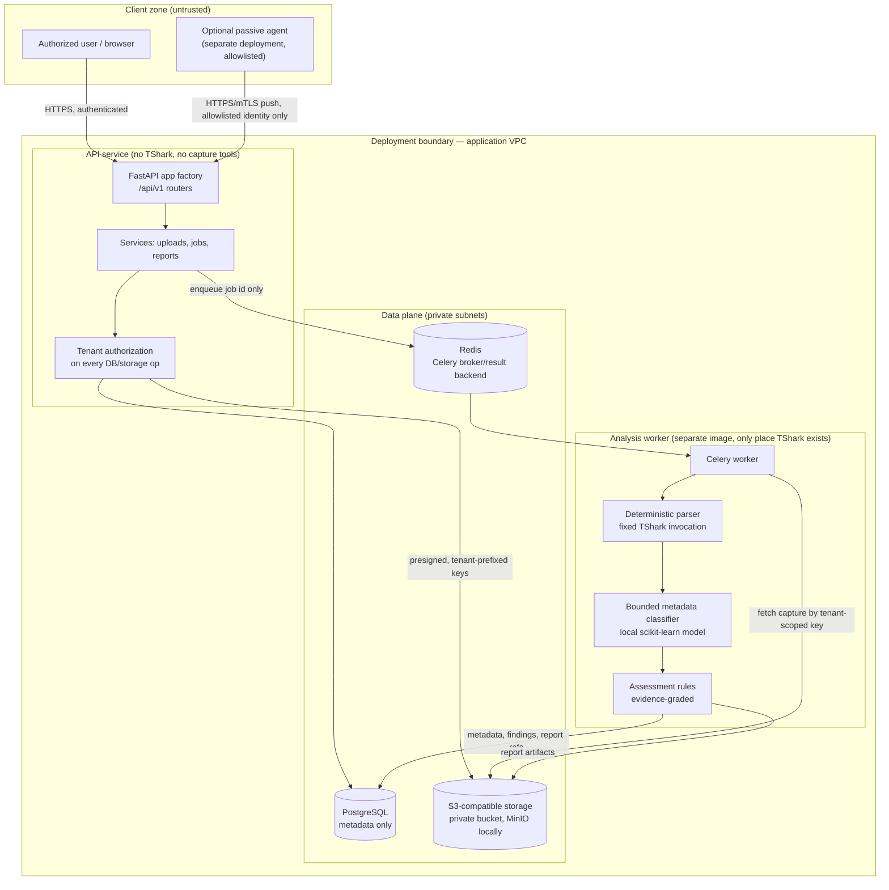
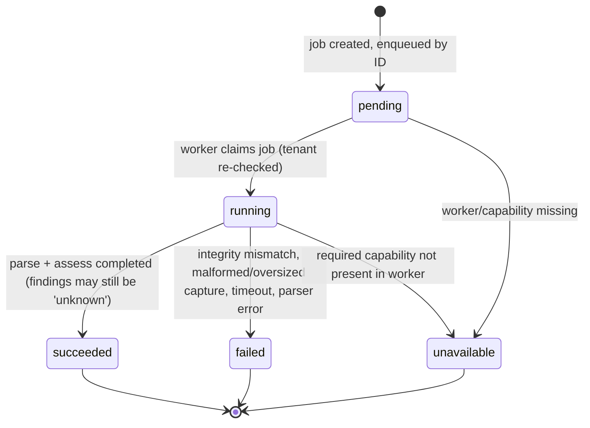

# Architecture — IPsec VPN Analysis Backend

> Status: **design document**. The repository currently contains only the scaffold
> (app factory, config, structured logging, health endpoints, ORM models). Upload,
> parsing, classification, assessment, and reporting described here are **planned**,
> not implemented. Nothing in this document is a claim that a capability exists today.

## 1. Purpose, scope, and hard limits

The MVP processes **PCAP/PCAPNG files uploaded by authorized users** and produces an
evidence-based assessment of the IPsec/IKE traffic visible in the capture.

In scope (MVP):
- Authenticated, tenant-scoped upload of `.pcap` / `.pcapng` files with size,
  packet-count, and processing-time limits.
- Asynchronous analysis (deterministic parsing first, bounded ML second — ADR-0006).
- Tenant-scoped storage of captures, extracted metadata, and reports.

Out of scope — **will not be built**:
- Packet injection, active probing/scanning, or any interaction with live endpoints.
- Key recovery, ESP/IKE decryption, brute force, or PSK/private-key upload or handling.
- Sending PCAPs, packet contents, or derived packet data to any external LLM or
  third-party AI service. All processing is local to the deployment.
- Live capture performed by the API. Live collection, if ever enabled, is a separate
  optional **passive agent** (Section 5.3) — never `tcpdump`/TShark spawned by the API,
  and never a shell command, interface name, filter, path, or TShark argument supplied
  by a user.

### 1.1 Visibility limits (read before trusting any output)

A passive capture shows only what traversed the capture point, and much of IPsec is
cryptographically opaque. The system must surface these as `unknown`, never as secure:

| Question | From a passive capture? |
|---|---|
| ESP payload contents / application identity inside the tunnel | **No.** ESP contents are encrypted. Traffic volume, timing, packet sizes, outer endpoints, and SPIs may be observable; inner application identity generally is not. |
| IKEv2 proposals offered in `IKE_SA_INIT` | Partially — initial IKE SA proposals are exchanged before encryption, *if* the capture includes them and starts before negotiation. |
| Full IKEv2 negotiation outcome | Often **no.** `IKE_AUTH` and later IKE messages are encrypted; the negotiated result may not be recoverable if the capture misses `IKE_SA_INIT` or starts mid-session. |
| Child-SA settings (algorithms, selectors) | May **not** be recoverable — negotiated inside encrypted IKE messages. |
| Perfect Forward Secrecy (PFS) in use | May **not** be recoverable for the same reason; absence of evidence is not evidence of absence. |
| Replay-window configuration | A local endpoint setting; generally **not** visible passively. Duplicate/replayed ESP sequence observations are not proof of the configured window. |
| SA lifetimes (configured) | Configured lifetimes are **not** directly visible; only observed rekey timing, if a rekey happens to occur during the capture window. |
| Whether algorithms in use are "strong" | Only for parameters actually observed with `packet_observed` evidence (Section 7). Anything unobserved is `unknown`. |

Consequences: the assessment engine must distinguish *observed weak* from
*not observed*, must never emit "compliant"/"secure" for properties it could not see,
and every finding must carry its evidence class and provenance.

## 2. Component diagram



Trust boundaries crossed: client→API (authentication, tenant authorization),
API→data plane (private network, per-service credentials), broker→worker (job IDs
only, no file paths/commands), worker→storage (scoped credentials, tenant-prefixed
keys verified against the job's tenant).

## 3. Data-flow diagram (upload → report)

```mermaid
sequenceDiagram
    participant U as User
    participant API as API (def handlers)
    participant S3 as Object storage
    participant PG as PostgreSQL
    participant R as Redis/Celery
    participant W as Worker (TShark image)
    U->>API: POST /api/v1/captures (multipart, authenticated)
    API->>API: Validate tenant, content type, size limit (streaming)
    API->>S3: Stream upload to tenants/{tenant}/captures/{id}/…
    API->>API: Compute SHA-256 while streaming
    API->>PG: Insert Capture(metadata, sha256, status=uploaded)
    API-->>U: 201 capture metadata (no packet data echoed)
    U->>API: POST /api/v1/captures/{id}/jobs
    API->>PG: Insert AnalysisJob(status=pending, tenant-scoped)
    API->>R: Enqueue(job_id)
    R->>W: Deliver job_id
    W->>PG: Load job + capture (tenant check), status=running
    W->>S3: Download to isolated temp dir (size/time caps)
    W->>W: Verify SHA-256; mismatch → failed, no parsing
    W->>W: capinfos/TShark with fixed args, timeouts, packet cap
    W->>W: Deterministic evidence extraction → ML metadata classification → rules
    W->>PG: Store metadata/findings (evidence-graded), status=succeeded|failed
    W->>S3: Store report artifact under tenant prefix
    U->>API: GET /api/v1/jobs/{id} / GET /api/v1/jobs/{id}/report
    API->>PG: Tenant-scoped read
    API-->>U: Status / report (unknowns explicit)
```

The capture bytes flow client→storage and storage→worker only. The broker carries
only job IDs; the database stores metadata, never PCAP bytes; API responses never
echo packet contents.

## 4. Deployment boundaries

| Boundary | Rules |
|---|---|
| API image | FastAPI/uvicorn only. **No TShark, no tcpdump, no packet tools.** Cannot execute shell commands from request data. Egress restricted to PostgreSQL, Redis, object storage. |
| Worker image | Separate image containing TShark (`Dockerfile.worker`). Runs as non-root, read-only root FS, isolated temp dir, CPU/memory/time limits, no inbound ports. This is the only component that touches untrusted capture bytes with a parser. |
| PostgreSQL | Private subnet; metadata only (no PCAP bytes, no secrets, no packet payloads). TLS + least-privilege role per service. |
| Object storage | Private bucket, versioning on, no public ACLs/policies. Access only via tenant-prefixed keys (`tenants/{tenant_id}/captures/{capture_id}/…`) generated server-side from validated IDs; user filenames are sanitized, never used as raw paths. MinIO for local dev only. |
| Redis | Private subnet, authenticated, TLS where supported. Payloads contain job IDs only — no paths, filters, commands, or packet data. |
| Secrets | Environment/secret-manager injection only; never in git, images, logs, or the database. `.env.example` contains placeholders only. |
| Network | Worker has no internet egress (model and dependencies are baked into the image). Nothing is sent to external AI/LLM services. |

### 4.1 Optional passive agent (post-MVP, separate system)
- A standalone agent deployed by the tenant on their own capture point, **explicitly
  allowlisted** (enrolled identity, e.g. mTLS certificate + tenant binding) before it
  can submit anything.
- The agent captures passively on its own host and *pushes finished capture files* to
  the same upload API. The API never connects to, commands, or configures the agent,
  and never runs `tcpdump`/TShark itself.
- Agent submissions are subject to identical size/rate/tenant limits, and agent
  identity maps to exactly one tenant. Revoking the allowlist entry disables ingestion.

## 5. Core entities

Existing ORM models (`src/ipsec_analyzer/models/`) plus planned additions:

| Entity | Key fields | Notes |
|---|---|---|
| `Tenant` | id, name, created_at | Isolation root. Every other row carries `tenant_id`. |
| `User` | id, tenant_id (FK), email (unique per tenant) | Authentication itself is a later stage; authorization always resolves tenant from the authenticated principal, never from client-supplied IDs. |
| `Capture` | id, tenant_id, uploaded_by, object_key, sha256 (hex), size_bytes, status (`uploaded/verifying/ready/rejected/unknown`) | Metadata only; bytes live in object storage. SHA-256 verified after upload and again by the worker before parsing. |
| `AnalysisJob` | id, tenant_id, capture_id, status (Section 6), status_detail | One capture may have multiple jobs; each job is tenant-scoped and references exactly one capture of the same tenant. |
| `Finding` *(planned)* | job_id, tenant_id, rule_id, evidence_class, observed_value, status | No finding without an evidence class; `unknown` is a first-class status. |
| `Report` *(planned)* | job_id, tenant_id, object_key, generated_at | Artifact in object storage under the tenant prefix; access only via tenant-checked API. |
| `AgentIdentity` *(planned, post-MVP)* | tenant_id, credential fingerprint, allowlisted, revoked_at | Maps a passive agent to exactly one tenant. |

## 6. API outline (`/api/v1`, planned except health)

| Endpoint | Description |
|---|---|
| `GET /health/live`, `GET /health/ready` | Implemented. Ready only when PostgreSQL answers, else `503 unavailable`. |
| `POST /captures` | Streaming multipart upload; extension/content checks, size cap, SHA-256 computed during streaming. Returns metadata only. |
| `GET /captures`, `GET /captures/{id}` | Tenant-scoped listing/read. Cross-tenant IDs return 404 (existence is not leaked). |
| `DELETE /captures/{id}` | Schedules deletion per Section 8. |
| `POST /captures/{id}/jobs` | Creates an analysis job for an owned capture; enqueue by job ID only. |
| `GET /jobs/{id}` | Status + evidence-graded findings (unknowns explicit). |
| `GET /jobs/{id}/report` | Report artifact download after tenant check (short-lived presigned URL or streamed). |
| `POST /agents/...` *(post-MVP)* | Agent enrollment/ingestion for allowlisted identities only. |

All handlers performing blocking DB/storage I/O are sync `def` handlers. No endpoint
accepts shell commands, TShark arguments/filters, file paths, or interface names.

## 7. Evidence classes (normative vocabulary)

Every extracted fact and finding is labelled with exactly one class:

| Class | Meaning | May support a security conclusion? |
|---|---|---|
| `packet_observed` | Directly decoded from packets in the capture by the deterministic parser (e.g. an IKE_SA_INIT proposal actually present). | Yes, scoped to what was observed. |
| `lab_manifest` | Declared in a trusted lab/test manifest describing how the capture was generated (ground truth for evaluation, not user traffic truth). | For evaluation/corroboration only; labelled as declared, not observed. |
| `analyst_supplied` | Asserted by an authorized analyst (e.g. "PFS is enabled on these gateways"). | Recorded as an assertion with attribution; never re-labelled as observed. |
| `model_inferred` | Produced by the bounded metadata classifier (ADR-0006). | Probabilistic hint only; must carry model version and confidence, and must never be the sole basis for a cryptographic or compliance claim. |
| `unknown` | Not observable from the available evidence (e.g. Child-SA settings hidden in encrypted IKE_AUTH, capture started mid-session). | No. The UI/report must show `unknown` / insufficient evidence, not a pass. |

Rules: classes never get "upgraded" silently (an inference corroborated by a packet
becomes a separate `packet_observed` fact); assessment output must cite the class(es)
behind each statement; aggregate scores must not average away `unknown`s.

## 8. Job lifecycle



- `succeeded` means the pipeline ran — **not** that the VPN is secure. Findings inside
  a succeeded job may be `unknown`.
- Failures are terminal with a sanitized `status_detail` (no packet data, no stack
  traces). Retry, if offered later, creates a new job rather than mutating history.
- Hard limits enforced in the worker: wall-clock timeout (Celery soft/hard limits),
  packet-count cap, temp-disk cap; exceeding any → `failed` with reason `limit_exceeded`.
- A capability that is not implemented returns `unavailable` — never a fabricated success.

## 9. Error handling

| Layer | Behaviour |
|---|---|
| API validation | Pydantic v2 schemas; 422 with field-level detail, no internal messages. |
| AuthN/AuthZ (later stage) | 401 unauthenticated; cross-tenant access → 404 (no existence leak); every DB/storage operation is tenant-scoped in the query/key, not filtered after the fact. |
| Upload | Streaming size cap → 413; wrong type/extension → 415/422; SHA-256/integrity failure → capture `rejected`, bytes quarantined for deletion. |
| Dependencies | Readiness reflects reality (503 when DB is down). API returns 503 `unavailable` rather than fabricating state when a dependency is unreachable. |
| Worker | Malformed PCAP, TShark non-zero exit, timeout, or limit breach → job `failed` with a coarse sanitized reason code (`malformed_capture`, `integrity_mismatch`, `limit_exceeded`, `parser_error`, `timeout`). Raw parser stderr is not stored or returned (may contain packet-derived data). |
| Responses | Stable error envelope: `{code, message, request_id}`; logs are structured JSON with request/job IDs and **never** packet contents, credentials, or secrets. Unknown evidence is represented as data (`unknown`), not as an error and not as success. |

## 10. Retention and deletion flow

1. **Defaults**: retention period is per-tenant configuration (planned); until set,
   captures and reports are retained until explicitly deleted. Access is logged as
   metadata (who/when/what ID) — never packet contents.
2. **Delete request** (`DELETE /captures/{id}`, tenant-checked): capture is tombstoned
   immediately — it disappears from listings and new jobs are refused.
3. **Object deletion**: all storage versions under the capture's tenant prefix are
   deleted (including report artifacts of its jobs); deletion is verified by a
   follow-up existence check.
4. **Metadata**: capture/job/finding rows are hard-deleted, or anonymized where an
   audit record must remain (IDs and timestamps only, no filenames beyond the
   sanitized stored name, no packet data — none is ever in the DB).
5. **Backups**: deletions propagate on backup expiry; the maximum backup lag is
   documented per deployment and stated honestly as the true deletion deadline.
6. **Tenant offboarding**: the same flow runs for every capture/report of the tenant,
   storage credentials and agent allowlist entries are revoked, then tenant rows are removed.
7. **Legal hold** (if ever required) suspends steps 3–4 for named captures only and is
   itself audit-logged.

## 11. Package layout (existing scaffold)

`api/`, `core/`, `db/`, `models/`, `schemas/`, `services/`, `storage/`, `workers/`
(canonical Celery app; `tasks/` is a compat re-export), `pipeline/`, `evidence/`,
`parsing/`, `ml/`, `assessment/`, `reporting/` under `src/ipsec_analyzer/`; tests in
top-level `tests/`. Local commands are documented in `README.md` and Section 4 of
earlier scaffold notes:

```bash
uv sync --frozen --group dev
uv run uvicorn ipsec_analyzer.main:app --host 0.0.0.0 --port 8000
uv run pytest -q
uv run ruff check src tests
```
